# Assets 3D d'Aelúmara

Catalogue de tous les modèles 3D low-poly récupérés pour l'île, classés par catégorie, avec un aperçu de chaque pack. On a tout téléchargé d'abord, on choisira ensuite. **Rien n'est encore utilisé par la page** [aelumara.pages.dev](https://aelumara.pages.dev/).

Mise à jour : 2026-10-25. Sur GitHub, appuie sur une image pour l'agrandir.

## Sources

| Source | Licence | Contenu | Détail |
|---|---|---|---|
| [Kenney](https://kenney.nl/assets/category:3D) | CC0 | 50 packs, environ 4 700 modèles, format glb (3 packs de personnages animés en FBX) | [kenney/README.md](kenney/README.md) |
| [Quaternius](https://quaternius.com/) | CC0 | 14 packs low-poly (médiane 1 500 triangles ou moins), OBJ, FBX et un pack glTF | [quaternius/README.md](quaternius/README.md) |
| [Free Game Assets / CraftPix](https://free-game-assets.itch.io/) | gratuit, licence CraftPix à vérifier | 9 packs (plantes, pierres, arbres, animal sauvage, palmier, décor, médiéval) ; fichiers bruts dans box, pas ici | [free-game-assets/README.md](free-game-assets/README.md) |
| [KayKit](https://kaylousberg.itch.io/) | CC0 | 4 packs (forêt, outils, ressources, cimetière), format glTF, FBX et OBJ | [kaykit/README.md](kaykit/README.md) |

Aucun crédit n'est exigé (CC0). Les glb et glTF se chargent directement dans [Three.js](https://threejs.org/), les OBJ et FBX aussi avec leurs chargeurs.

## Catégories

- [🌴 Nature et île](#nature-et-île) (7 packs)
- [⛵ Bateaux, mer et pirates](#bateaux-mer-et-pirates) (2 packs)
- [🏘️ Village et bâtiments](#village-et-bâtiments) (6 packs)
- [🏙️ Ville et routes](#ville-et-routes) (8 packs)
- [🧑 Personnages](#personnages) (6 packs)
- [🐾 Animaux et créatures](#animaux-et-créatures) (5 packs)
- [🏰 Donjons, cavernes et fantasy](#donjons-cavernes-et-fantasy) (7 packs)
- [🍎 Objets, nourriture et intérieur](#objets-nourriture-et-intérieur) (6 packs)
- [🚗 Véhicules](#véhicules) (5 packs)
- [🚀 Espace et science-fiction](#espace-et-science-fiction) (4 packs)
- [🔫 Armes](#armes) (2 packs)
- [⛏️ Outils et ressources](#outils-et-ressources) (2 packs)
- [🎮 Jeux et plateformes](#jeux-et-plateformes) (8 packs)

## 🌴 Nature et île

Arbres, rochers, plantes, tuiles de terrain, camp. La base pour refaire l'île.

### Nature Kit

Kenney · 329 modèles · dossier [`kenney/nature-kit`](kenney/nature-kit) · [page](https://kenney.nl/assets/nature-kit)

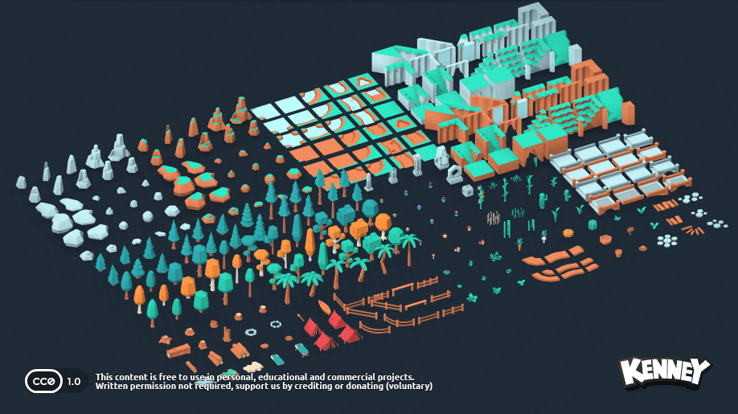

### Mini Forest

Kenney · 22 modèles · dossier [`kenney/mini-forest`](kenney/mini-forest) · [page](https://kenney.nl/assets/mini-forest)

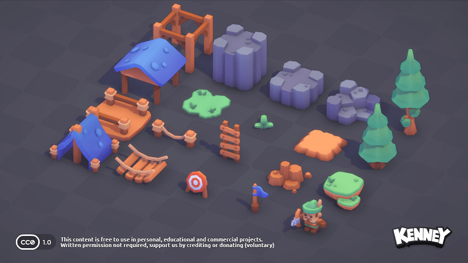

### Hexagon Kit

Kenney · 72 modèles · dossier [`kenney/hexagon-kit`](kenney/hexagon-kit) · [page](https://kenney.nl/assets/hexagon-kit)

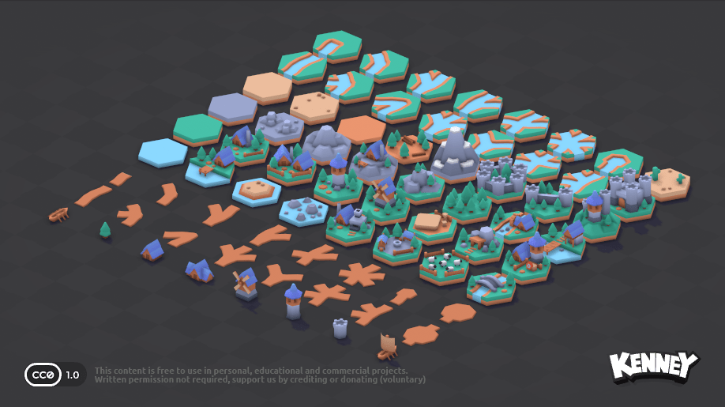

### Survival Kit

Kenney · 80 modèles · dossier [`kenney/survival-kit`](kenney/survival-kit) · [page](https://kenney.nl/assets/survival-kit)

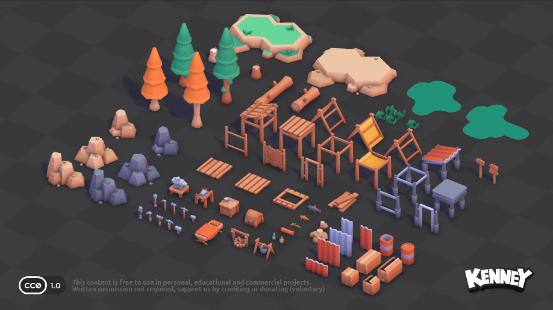

### 150 Lowpoly Nature Models

Quaternius · 150 modèles · dossier [`quaternius/150-lowpoly-nature-models`](quaternius/150-lowpoly-nature-models) · [page](https://quaternius.itch.io/150-lowpoly-nature-models) · [autres aperçus](quaternius/150-lowpoly-nature-models/Preview-2.png)

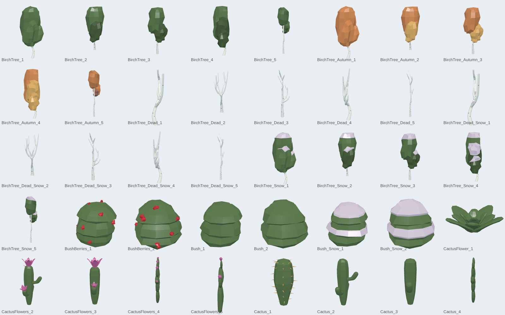

### Textured Lowpoly Trees

Quaternius · 45 modèles · dossier [`quaternius/textured-lowpoly-trees`](quaternius/textured-lowpoly-trees) · [page](https://quaternius.itch.io/textured-lowpoly-trees) · [autres aperçus](quaternius/textured-lowpoly-trees/Preview-2.png)

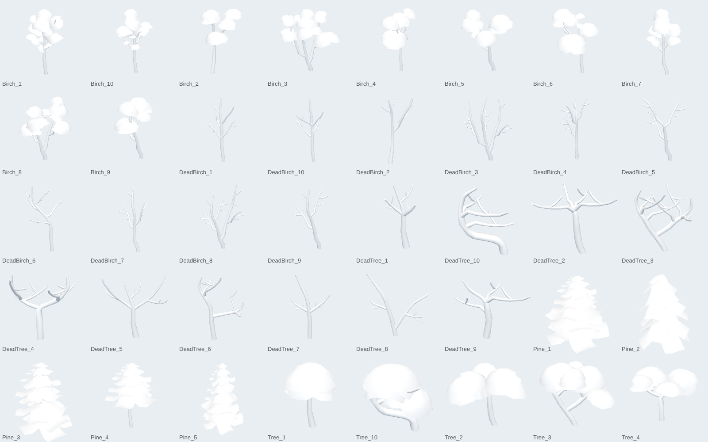

### KayKit Forest Nature Pack

Arbres, buissons, herbes et rochers, en style très doux. Pour l'île.

KayKit · 105 modèles · dossier [`kaykit/kaykit-forest`](kaykit/kaykit-forest) · [page](https://kaylousberg.itch.io/kaykit-forest) · [autres aperçus](kaykit/kaykit-forest/Preview-2.png)

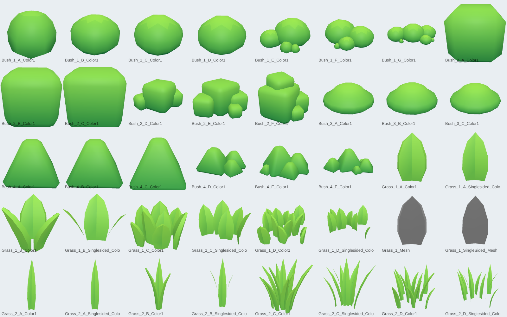

### Free Tropical Palm Tree

Free Game Assets · 20 palmiers, FBX · dossier `box/05_Attachments/assets-craftpix/` · [page](https://free-game-assets.itch.io/free-tropical-palm-tree-3d-low-poly-pack)

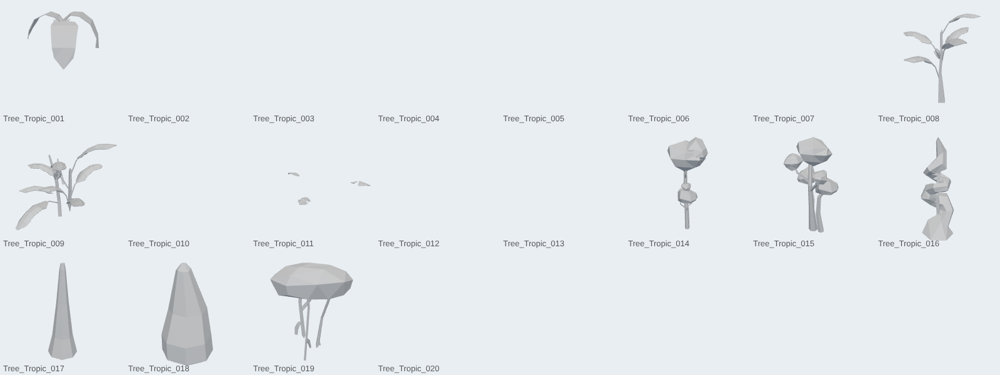

### Free Bush

Free Game Assets · 20 buissons, FBX · dossier `box/05_Attachments/assets-craftpix/` · [page](https://free-game-assets.itch.io/free-bush-3d-low-poly-pack)

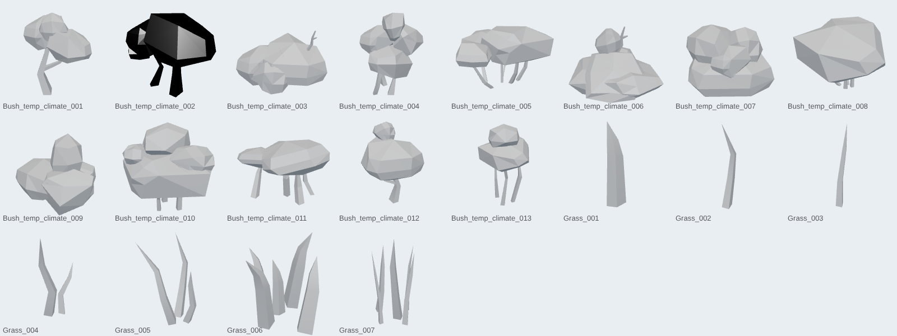

### Free Desert Plants

Free Game Assets · 20 plantes du désert, FBX · dossier `box/05_Attachments/assets-craftpix/` · [page](https://free-game-assets.itch.io/free-desert-plants-3d-low-poly-pack)

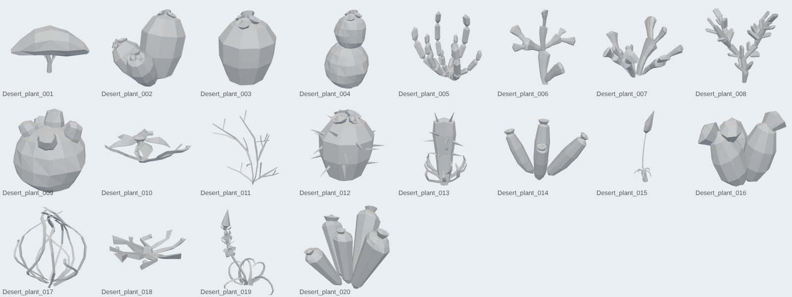

### Free Shrubs, Flowers and Mushrooms

Free Game Assets · 20 arbustes, fleurs et champignons, FBX · dossier `box/05_Attachments/assets-craftpix/` · [page](https://free-game-assets.itch.io/free-shrubs-flowers-and-mushrooms-3d-low-poly-pack)

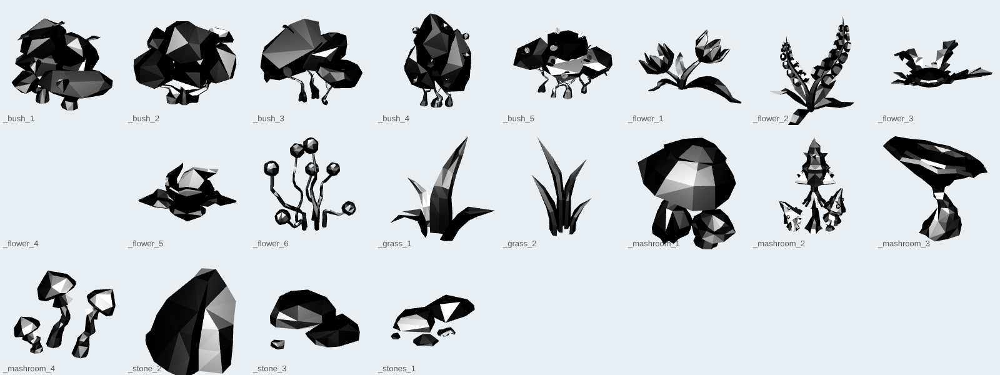

### Free Stone

Free Game Assets · 40 pierres, FBX · dossier `box/05_Attachments/assets-craftpix/` · [page](https://free-game-assets.itch.io/free-stone-3d-low-poly-pack)

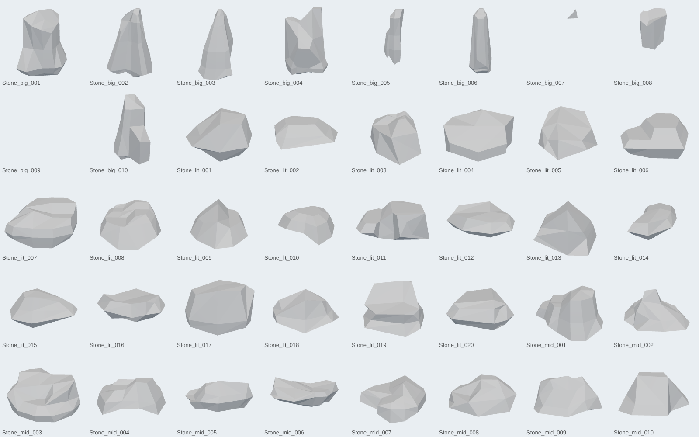

### Free Tree

Free Game Assets · 21 arbres, FBX (à écarter : feuillus et pins) · dossier `box/05_Attachments/assets-craftpix/` · [page](https://free-game-assets.itch.io/free-tree-3d-low-poly-models)

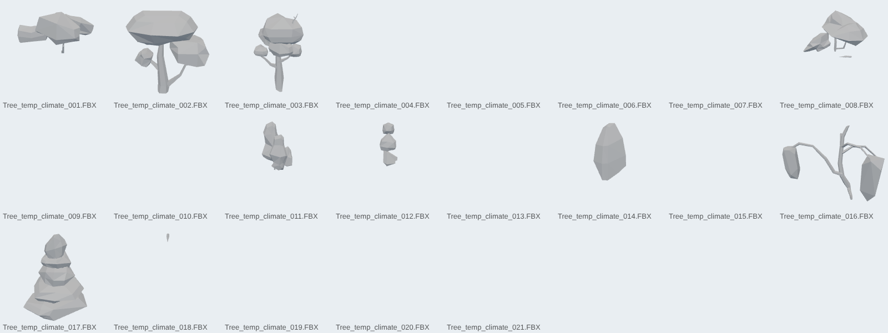

## ⛵ Bateaux, mer et pirates

Pour le radeau, le port et la traversée vers l'autre île.

### Pirate Kit

Kenney · 72 modèles · dossier [`kenney/pirate-kit`](kenney/pirate-kit) · [page](https://kenney.nl/assets/pirate-kit)

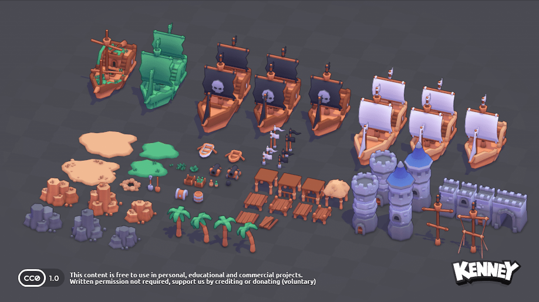

### Watercraft Kit

Kenney · 46 modèles · dossier [`kenney/watercraft-kit`](kenney/watercraft-kit) · [page](https://kenney.nl/assets/watercraft-kit)

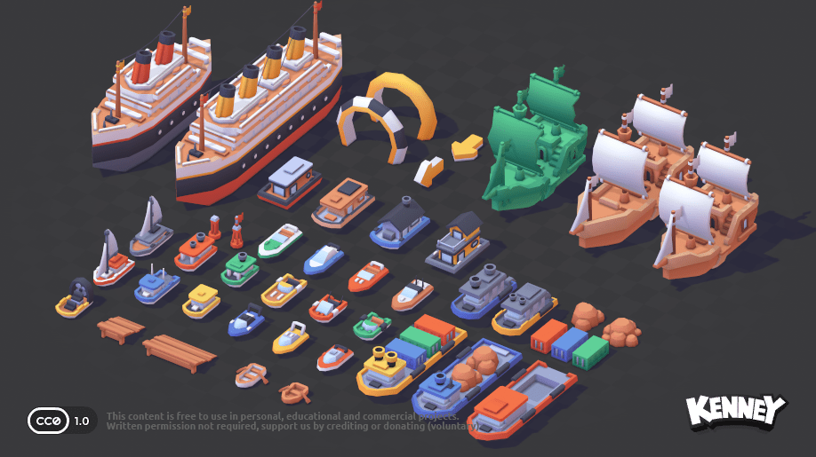

## 🏘️ Village et bâtiments

Cabanes, maisons, tours, murs.

### Fantasy Town Kit

Kenney · 167 modèles · dossier [`kenney/fantasy-town-kit`](kenney/fantasy-town-kit) · [page](https://kenney.nl/assets/fantasy-town-kit)

### Castle Kit

Kenney · 76 modèles · dossier [`kenney/castle-kit`](kenney/castle-kit) · [page](https://kenney.nl/assets/castle-kit)

### Building Kit

Kenney · 79 modèles · dossier [`kenney/building-kit`](kenney/building-kit) · [page](https://kenney.nl/assets/building-kit)

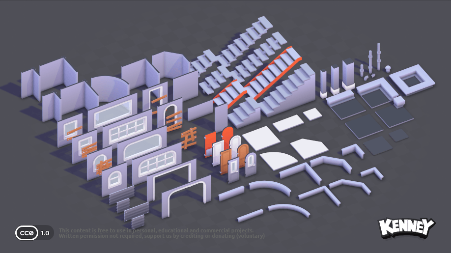

### Modular Buildings

Kenney · 108 modèles · dossier [`kenney/modular-buildings`](kenney/modular-buildings) · [page](https://kenney.nl/assets/modular-buildings)

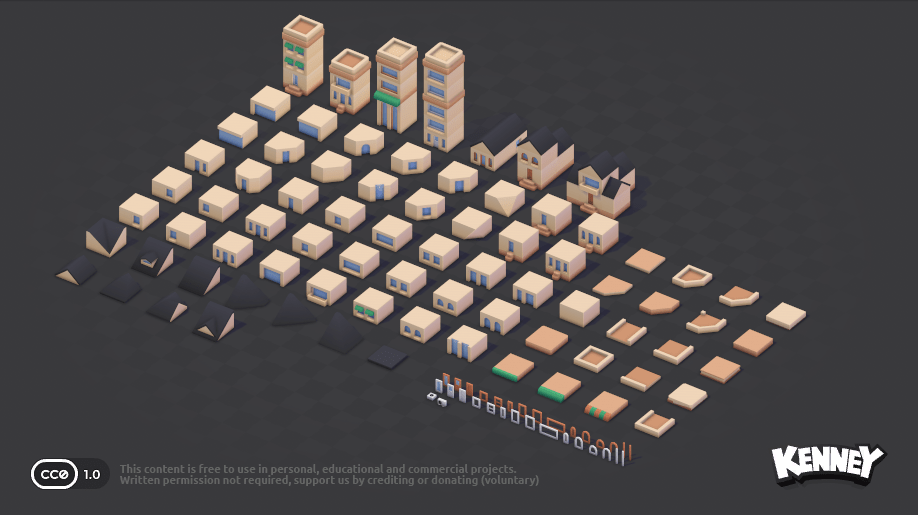

### Retro Fantasy Kit

Kenney · 105 modèles · dossier [`kenney/retro-fantasy-kit`](kenney/retro-fantasy-kit) · [page](https://kenney.nl/assets/retro-fantasy-kit)

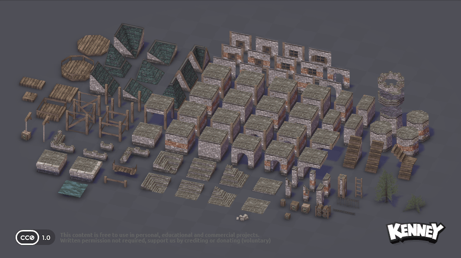

### Brick Kit

Kenney · 296 modèles · dossier [`kenney/brick-kit`](kenney/brick-kit) · [page](https://kenney.nl/assets/brick-kit)

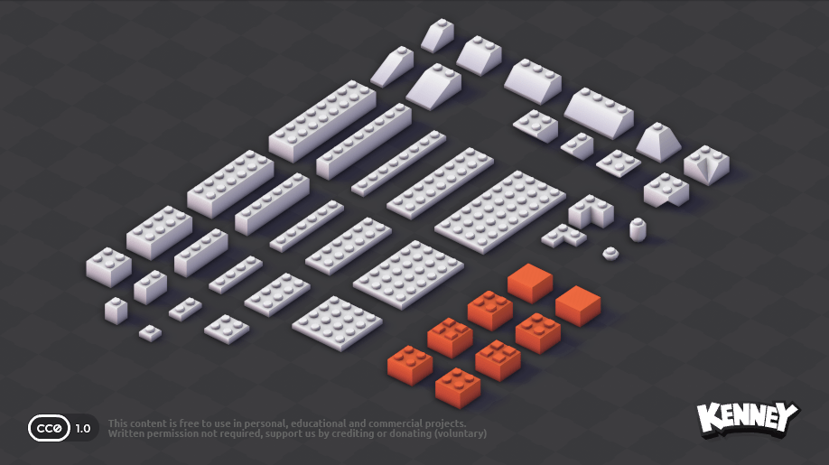

## 🏙️ Ville et routes

Peu utile pour une île, mais gardé pour plus tard.

### City Kit (Suburban)

Kenney · 40 modèles · dossier [`kenney/city-kit-suburban`](kenney/city-kit-suburban) · [page](https://kenney.nl/assets/city-kit-suburban)

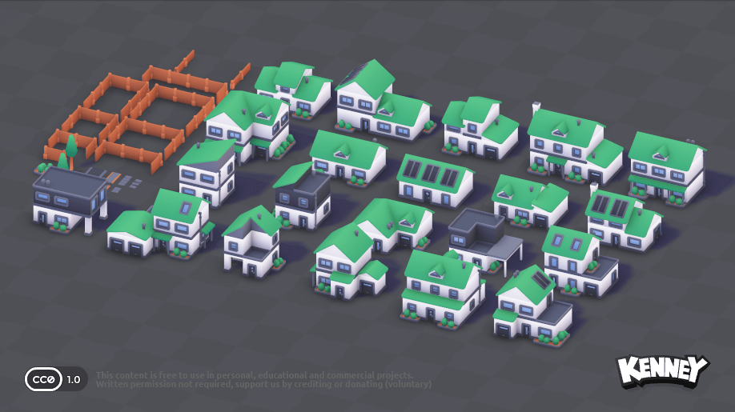

### City Kit (Commercial)

Kenney · 41 modèles · dossier [`kenney/city-kit-commercial`](kenney/city-kit-commercial) · [page](https://kenney.nl/assets/city-kit-commercial)

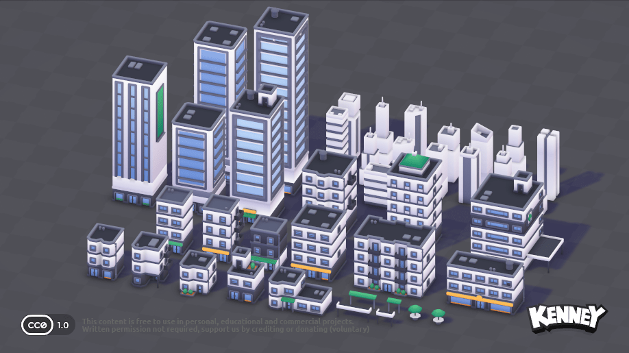

### City Kit (Industrial)

Kenney · 37 modèles · dossier [`kenney/city-kit-industrial`](kenney/city-kit-industrial) · [page](https://kenney.nl/assets/city-kit-industrial)

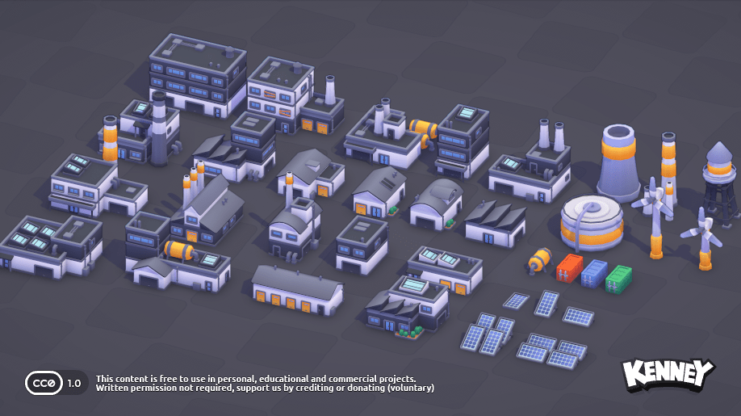

### City Kit (Roads)

Kenney · 95 modèles · dossier [`kenney/city-kit-roads`](kenney/city-kit-roads) · [page](https://kenney.nl/assets/city-kit-roads)

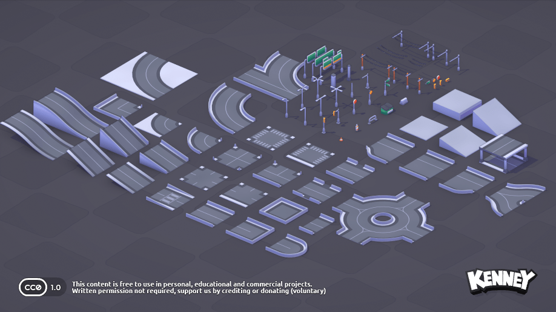

### 3D Road Tiles

Kenney · 302 modèles · dossier [`kenney/3d-road-tiles`](kenney/3d-road-tiles) · [page](https://kenney.nl/assets/3d-road-tiles)

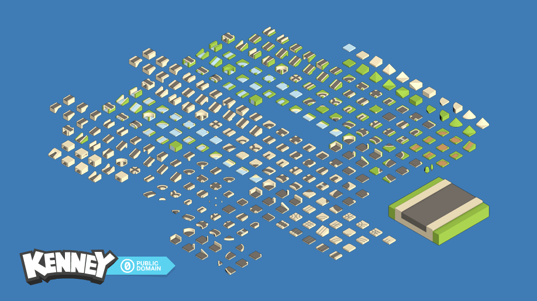

### Retro Urban Kit

Kenney · 124 modèles · dossier [`kenney/retro-urban-kit`](kenney/retro-urban-kit) · [page](https://kenney.nl/assets/retro-urban-kit)

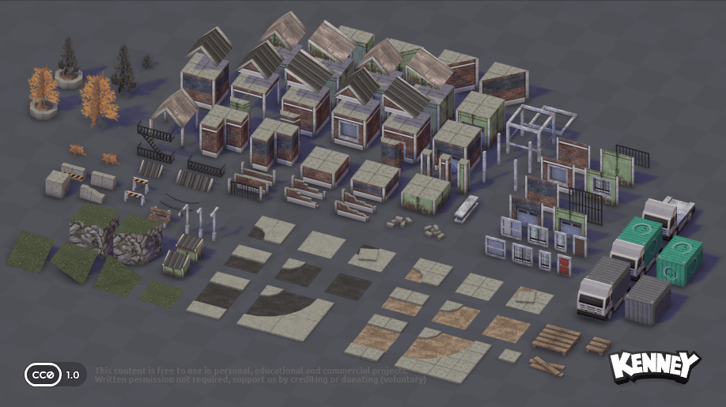

### Factory Kit

Kenney · 143 modèles · dossier [`kenney/factory-kit`](kenney/factory-kit) · [page](https://kenney.nl/assets/factory-kit)

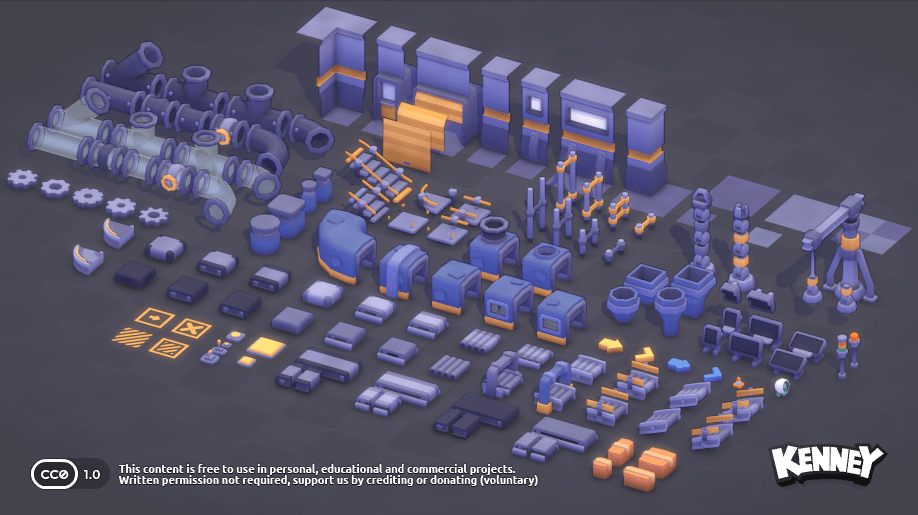

### Lowpoly Modular Street

Quaternius · 25 modèles · dossier [`quaternius/lowpoly-modular-street`](quaternius/lowpoly-modular-street) · [page](https://quaternius.itch.io/lowpoly-modular-street)

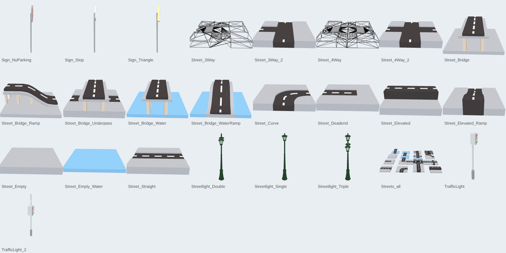

## 🧑 Personnages

Pour Bram, Sélie et Nilo. Les packs « animated » ont des animations (FBX).

### Animated Characters Protagonists

Kenney · 4 modèles · dossier [`kenney/animated-characters-protagonists`](kenney/animated-characters-protagonists) · [page](https://kenney.nl/assets/animated-characters-protagonists)

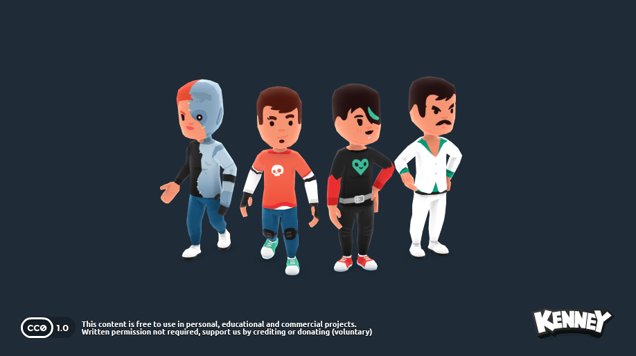

### Animated Characters Retro

Kenney · 4 modèles · dossier [`kenney/animated-characters-retro`](kenney/animated-characters-retro) · [page](https://kenney.nl/assets/animated-characters-retro)

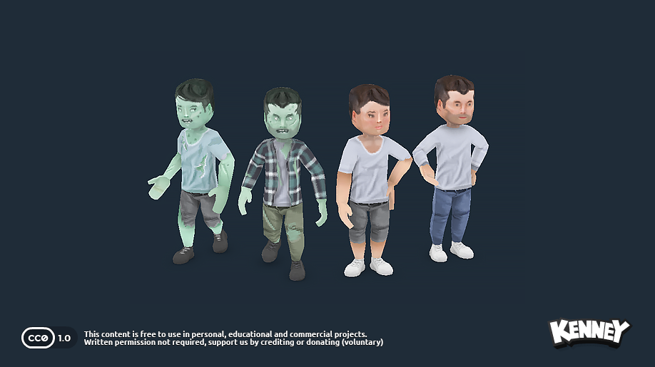

### Animated Characters Survivors

Kenney · 4 modèles · dossier [`kenney/animated-characters-survivors`](kenney/animated-characters-survivors) · [page](https://kenney.nl/assets/animated-characters-survivors)

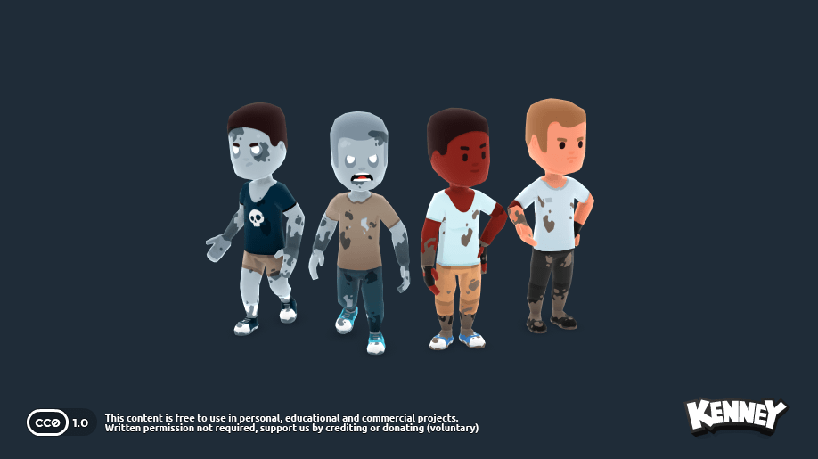

### Blocky Characters

Kenney · 18 modèles · dossier [`kenney/blocky-characters`](kenney/blocky-characters) · [page](https://kenney.nl/assets/blocky-characters)

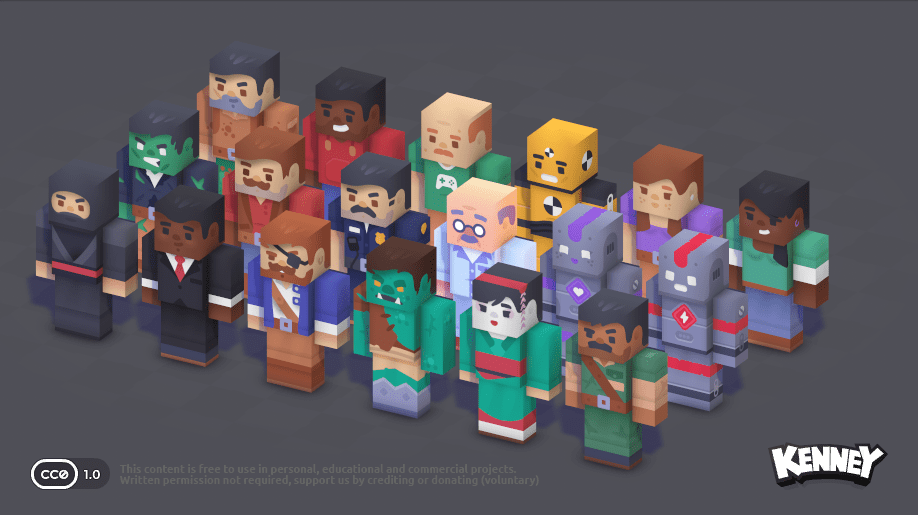

### Mini Characters

Kenney · 26 modèles · dossier [`kenney/mini-characters`](kenney/mini-characters) · [page](https://kenney.nl/assets/mini-characters)

### Lowpoly Animated Knight

Quaternius · 9 modèles · dossier [`quaternius/lowpoly-animated-knight`](quaternius/lowpoly-animated-knight) · [page](https://quaternius.itch.io/lowpoly-animated-knight)

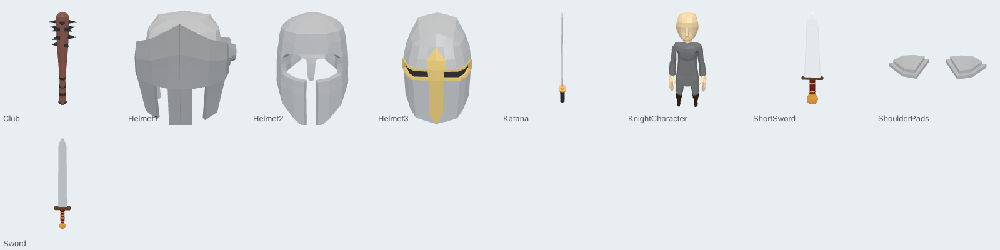

## 🐾 Animaux et créatures

Faune de l'île et de la mer.

### Cube Pets

Kenney · 24 modèles · dossier [`kenney/cube-pets`](kenney/cube-pets) · [page](https://kenney.nl/assets/cube-pets)

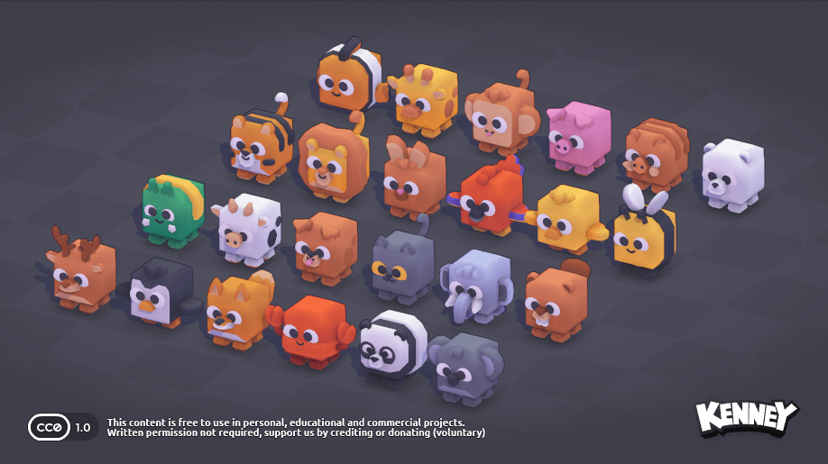

### Lowpoly Animated Animals

Quaternius · 7 modèles · dossier [`quaternius/lowpoly-animated-animals`](quaternius/lowpoly-animated-animals) · [page](https://quaternius.itch.io/lowpoly-animated-animals)

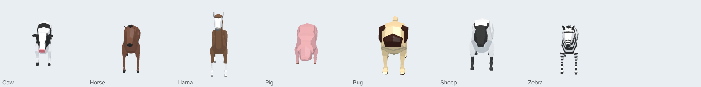

### Lowpoly Animated Fish

Quaternius · 7 modèles · dossier [`quaternius/lowpoly-animated-fish`](quaternius/lowpoly-animated-fish) · [page](https://quaternius.itch.io/lowpoly-animated-fish)

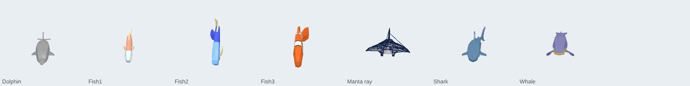

### Animated Lowpoly Dinosaurs

Quaternius · 6 modèles · dossier [`quaternius/animated-lowpoly-dinosaurs`](quaternius/animated-lowpoly-dinosaurs) · [page](https://quaternius.itch.io/animated-lowpoly-dinosaurs)

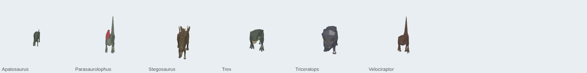

### Lowpoly Animated Monsters

Quaternius · 4 modèles · dossier [`quaternius/lowpoly-animated-monsters`](quaternius/lowpoly-animated-monsters) · [page](https://quaternius.itch.io/lowpoly-animated-monsters)

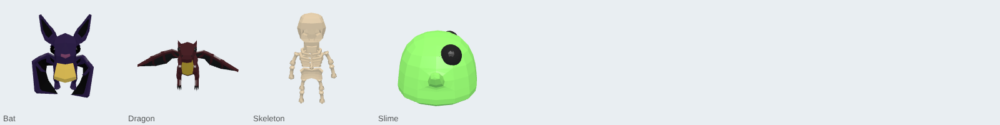

### Free Wild Animal

Free Game Assets · 20 animaux sauvages, FBX · dossier `box/05_Attachments/assets-craftpix/` · [page](https://free-game-assets.itch.io/free-wild-animal-3d-low-poly-models)

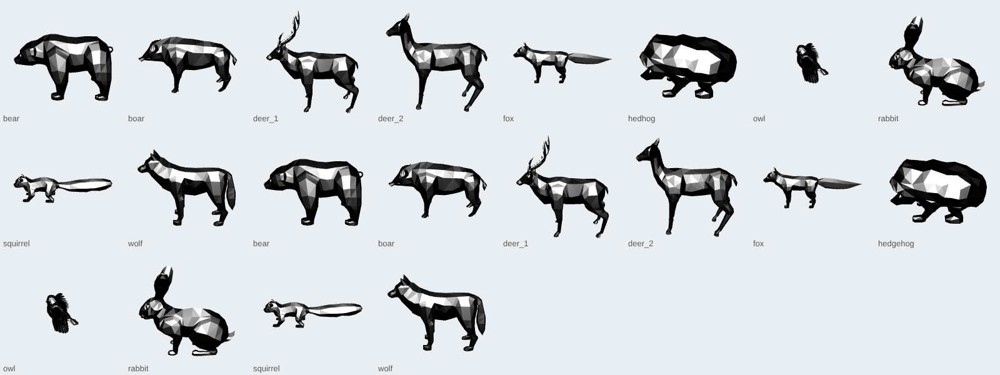

## 🏰 Donjons, cavernes et fantasy

Grottes, ruines, coffres, tonneaux, armes médiévales.

### Mini Dungeon

Kenney · 30 modèles · dossier [`kenney/mini-dungeon`](kenney/mini-dungeon) · [page](https://kenney.nl/assets/mini-dungeon)

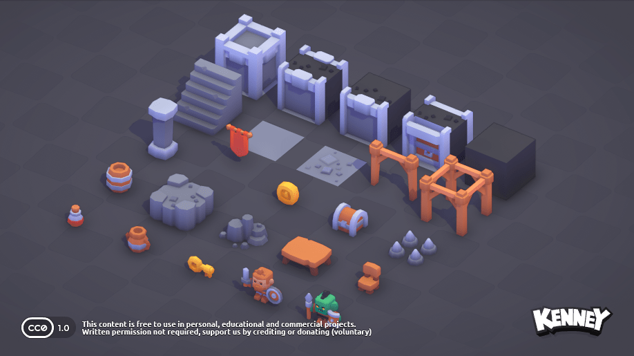

### Modular Dungeon Kit

Kenney · 39 modèles · dossier [`kenney/modular-dungeon-kit`](kenney/modular-dungeon-kit) · [page](https://kenney.nl/assets/modular-dungeon-kit)

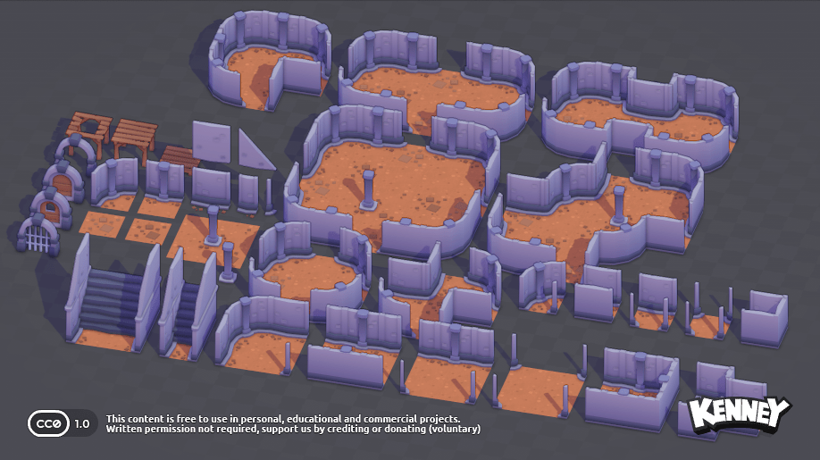

### Modular Cave Kit

Kenney · 40 modèles · dossier [`kenney/modular-cave-kit`](kenney/modular-cave-kit) · [page](https://kenney.nl/assets/modular-cave-kit)

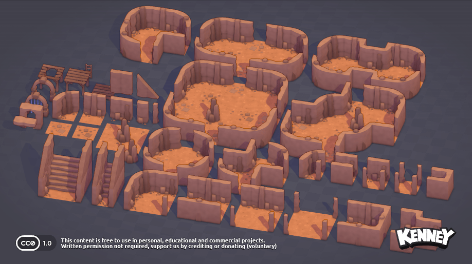

### Graveyard Kit

Kenney · 91 modèles · dossier [`kenney/graveyard-kit`](kenney/graveyard-kit) · [page](https://kenney.nl/assets/graveyard-kit)

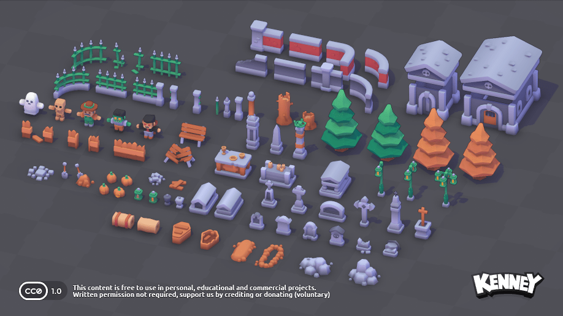

### Lowpoly Modular Dungeon Pack

Quaternius · 48 modèles · dossier [`quaternius/lowpoly-modular-dungeon-pack`](quaternius/lowpoly-modular-dungeon-pack) · [page](https://quaternius.itch.io/lowpoly-modular-dungeon-pack) · [autres aperçus](quaternius/lowpoly-modular-dungeon-pack/Preview-2.png)

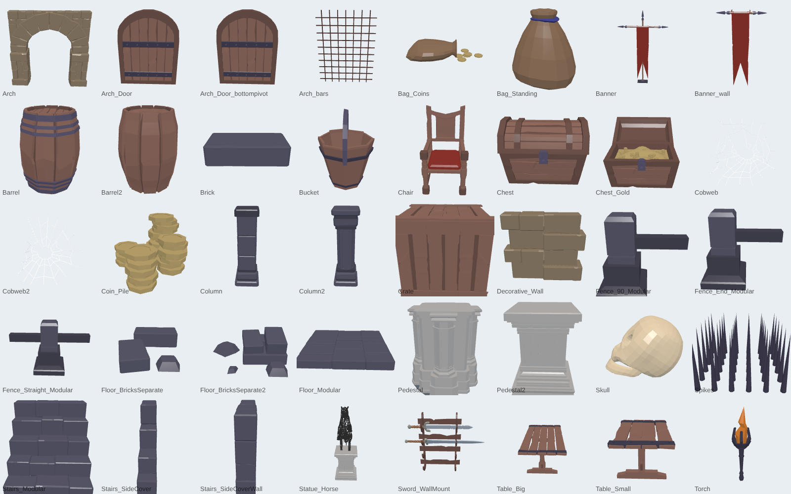

### Lowpoly Medieval Weapons

Quaternius · 24 modèles · dossier [`quaternius/lowpoly-medieval-weapons`](quaternius/lowpoly-medieval-weapons) · [page](https://quaternius.itch.io/lowpoly-medieval-weapons)

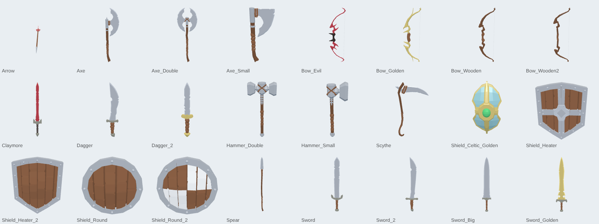

### KayKit Halloween Bits

Cimetière : pierres tombales, cercueils, grilles, lanternes et bougies. Ambiance nocturne ou ancien cimetière.

KayKit · 63 modèles · dossier [`kaykit/halloween-bits`](kaykit/halloween-bits) · [page](https://kaylousberg.itch.io/halloween-bits) · [autres aperçus](kaykit/halloween-bits/Preview-2.png)

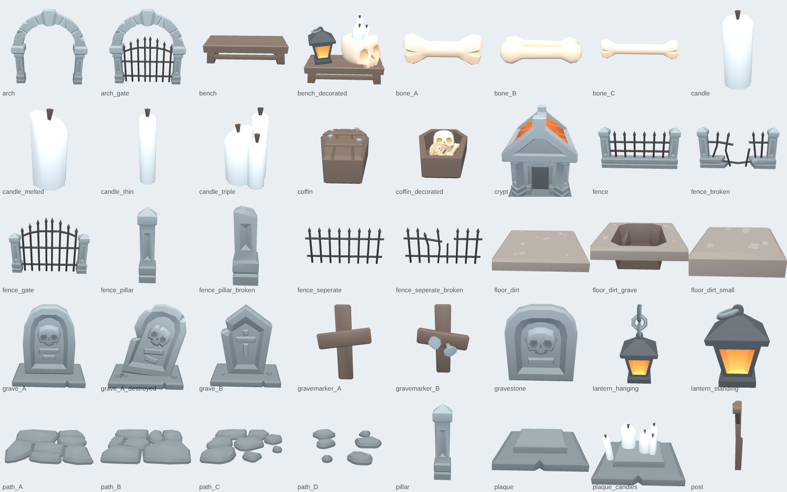

### Free Medieval Props

Free Game Assets · 28 accessoires médiévaux, FBX · dossier `box/05_Attachments/assets-craftpix/` · [page](https://free-game-assets.itch.io/free-medieval-props-3d-low-poly-models)

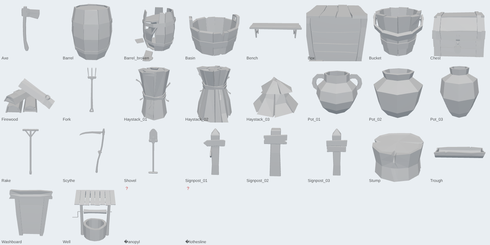

## 🍎 Objets, nourriture et intérieur

Baies, repas, meubles de cabane, étals, décors de fête.

### Food Kit

Kenney · 200 modèles · dossier [`kenney/food-kit`](kenney/food-kit) · [page](https://kenney.nl/assets/food-kit)

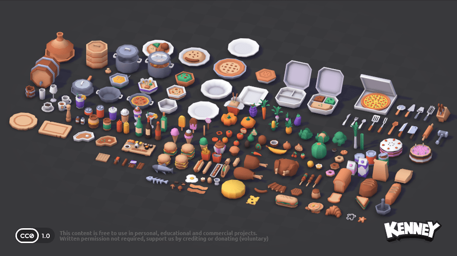

### Furniture Kit

Kenney · 140 modèles · dossier [`kenney/furniture-kit`](kenney/furniture-kit) · [page](https://kenney.nl/assets/furniture-kit)

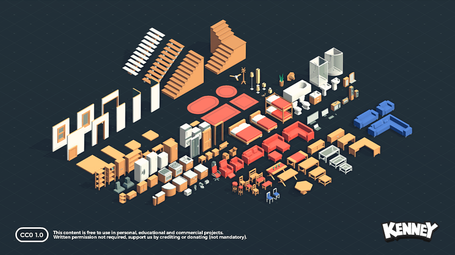

### Mini Market

Kenney · 20 modèles · dossier [`kenney/mini-market`](kenney/mini-market) · [page](https://kenney.nl/assets/mini-market)

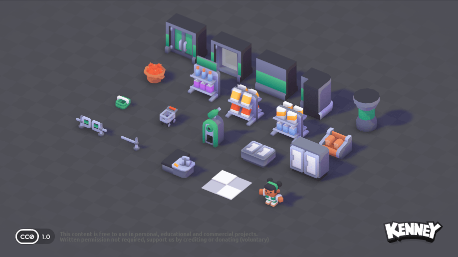

### Holiday Kit

Kenney · 99 modèles · dossier [`kenney/holiday-kit`](kenney/holiday-kit) · [page](https://kenney.nl/assets/holiday-kit)

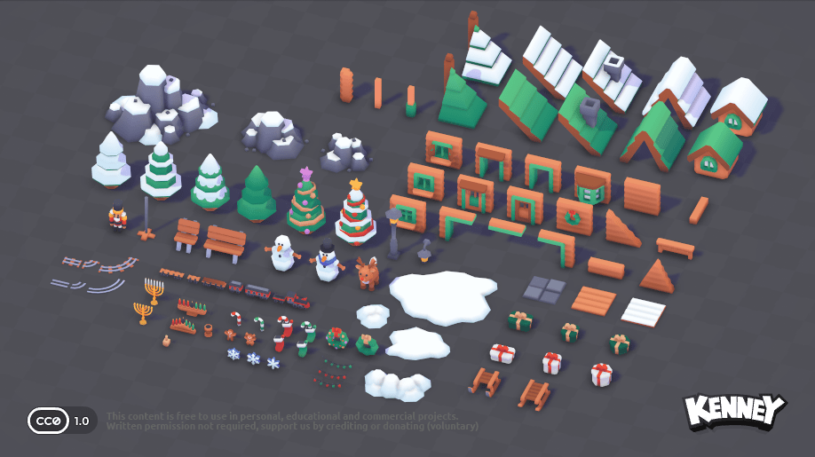

### Prototype Kit

Kenney · 145 modèles · dossier [`kenney/prototype-kit`](kenney/prototype-kit) · [page](https://kenney.nl/assets/prototype-kit)

### Mini Arcade

Kenney · 20 modèles · dossier [`kenney/mini-arcade`](kenney/mini-arcade) · [page](https://kenney.nl/assets/mini-arcade)

### Free Environment Props

Free Game Assets · 28 accessoires de décor, FBX · dossier `box/05_Attachments/assets-craftpix/` · [page](https://free-game-assets.itch.io/free-environment-props-3d-low-poly-pack)

## 🚗 Véhicules

Peu utile pour l'île.

### Car Kit

Kenney · 50 modèles · dossier [`kenney/car-kit`](kenney/car-kit) · [page](https://kenney.nl/assets/car-kit)

### Toy Car Kit

Kenney · 157 modèles · dossier [`kenney/toy-car-kit`](kenney/toy-car-kit) · [page](https://kenney.nl/assets/toy-car-kit)

### Racing Kit

Kenney · 112 modèles · dossier [`kenney/racing-kit`](kenney/racing-kit) · [page](https://kenney.nl/assets/racing-kit)

### Train Kit

Kenney · 103 modèles · dossier [`kenney/train-kit`](kenney/train-kit) · [page](https://kenney.nl/assets/train-kit)

### Coaster Kit

Kenney · 183 modèles · dossier [`kenney/coaster-kit`](kenney/coaster-kit) · [page](https://kenney.nl/assets/coaster-kit)

## 🚀 Espace et science-fiction

Pour plus tard, si l'histoire va dans le ciel.

### Space Kit

Kenney · 153 modèles · dossier [`kenney/space-kit`](kenney/space-kit) · [page](https://kenney.nl/assets/space-kit)

### Space Station Kit

Kenney · 97 modèles · dossier [`kenney/space-station-kit`](kenney/space-station-kit) · [page](https://kenney.nl/assets/space-station-kit)

### Modular Space Kit

Kenney · 40 modèles · dossier [`kenney/modular-space-kit`](kenney/modular-space-kit) · [page](https://kenney.nl/assets/modular-space-kit)

### Lowpoly Spaceships

Quaternius · 5 modèles · dossier [`quaternius/lowpoly-spaceships`](quaternius/lowpoly-spaceships) · [page](https://quaternius.itch.io/lowpoly-spaceships)

## 🔫 Armes

Probablement pas pour Aelúmara.

### Blaster Kit

Kenney · 40 modèles · dossier [`kenney/blaster-kit`](kenney/blaster-kit) · [page](https://kenney.nl/assets/blaster-kit)

### 50 Lowpoly Guns

Quaternius · 55 modèles · dossier [`quaternius/50-lowpoly-guns`](quaternius/50-lowpoly-guns) · [page](https://quaternius.itch.io/50-lowpoly-guns) · [autres aperçus](quaternius/50-lowpoly-guns/Preview-2.png)

## ⛏️ Outils et ressources

Outils de bricolage et lingots, pour les métiers et les ressources de l'île.

### KayKit RPG Tools Bits

Marteaux, haches, pioches, scies, cartes, lanternes et outils de bricolage. Utile pour les métiers de l'île.

KayKit · 49 modèles · dossier [`kaykit/rpg-tools-bits`](kaykit/rpg-tools-bits) · [page](https://kaylousberg.itch.io/rpg-tools-bits) · [autres aperçus](kaykit/rpg-tools-bits/Preview-2.png)

### KayKit Resource Bits

Lingots, pépites, tonneaux de carburant et palettes. Pour les ressources de l'île (bois, pierre, métaux).

KayKit · 76 modèles · dossier [`kaykit/resource-bits`](kaykit/resource-bits) · [page](https://kaylousberg.itch.io/resource-bits) · [autres aperçus](kaykit/resource-bits/Preview-2.png)

## 🎮 Jeux et plateformes

Décors et éléments de jeu génériques.

### Platformer Kit

Kenney · 153 modèles · dossier [`kenney/platformer-kit`](kenney/platformer-kit) · [page](https://kenney.nl/assets/platformer-kit)

### Marble Kit

Kenney · 162 modèles · dossier [`kenney/marble-kit`](kenney/marble-kit) · [page](https://kenney.nl/assets/marble-kit)

### Minigolf Kit

Kenney · 126 modèles · dossier [`kenney/minigolf-kit`](kenney/minigolf-kit) · [page](https://kenney.nl/assets/minigolf-kit)

### Mini Skate

Kenney · 42 modèles · dossier [`kenney/mini-skate`](kenney/mini-skate) · [page](https://kenney.nl/assets/mini-skate)

### Mini Arena

Kenney · 22 modèles · dossier [`kenney/mini-arena`](kenney/mini-arena) · [page](https://kenney.nl/assets/mini-arena)

### Tower Defense Kit

Kenney · 160 modèles · dossier [`kenney/tower-defense-kit`](kenney/tower-defense-kit) · [page](https://kenney.nl/assets/tower-defense-kit)

### Platformer Pack

Quaternius · 53 modèles · dossier [`quaternius/platformer-pack`](quaternius/platformer-pack) · [page](https://quaternius.itch.io/platformer-pack) · [autres aperçus](quaternius/platformer-pack/Preview-2.png)

### Ultimate Platformer Pack

Quaternius · 111 modèles · dossier [`quaternius/ultimate-platformer-pack`](quaternius/ultimate-platformer-pack) · [page](https://quaternius.itch.io/ultimate-platformer-pack) · [autres aperçus](quaternius/ultimate-platformer-pack/Preview-2.png)

## Mis de côté

Cinq gros packs de Quaternius aux textures réalistes (Medieval Village, Stylized Nature, Fantasy Props, Downtown City et Modular Sci-Fi MegaKits). Ils ont peu de triangles mais 50 à 90 Mo de textures chacun. À ajouter sur demande.

## Abandonné

Animal Kit de madtrollstudio sur [Poly Pizza](https://poly.pizza/bundle/Animal-Kit-J1PqAonfYb) (CC-BY) : le site bloque nos robots et le téléchargement manuel n'a pas marché. Laissé tomber le 2026-10-25 (décision de la propriétaire).

## Pas encore téléchargé

Autres sources de la [liste d'outils](https://github.com/jacqueline-saint-urbain/box/blob/main/00_Inbox/Outils%20low-poly%203D%20et%20UI%20de%20jeu.md) : [Jean Charpentier](https://jeancharpentier.itch.io/cc0-lowpoly-pack), [OpenGameArt](https://opengameart.org/).

## Pour ajouter une source

Créer `assets/<source>/` avec un `README.md` (auteur, licence, packs, format), puis ajouter ses packs à la bonne catégorie ci-dessus.
